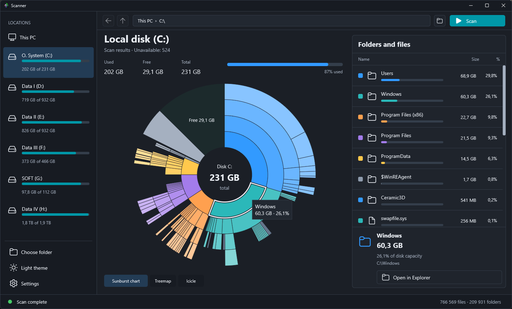

# ScannerFMX

A utility for analyzing occupied disk space for Windows, written in Delphi FireMonkey. Shows the sizes of folders and files using a ring diagram, Treemap, and Icicle. Supports light and dark themes, Russian and English languages.

